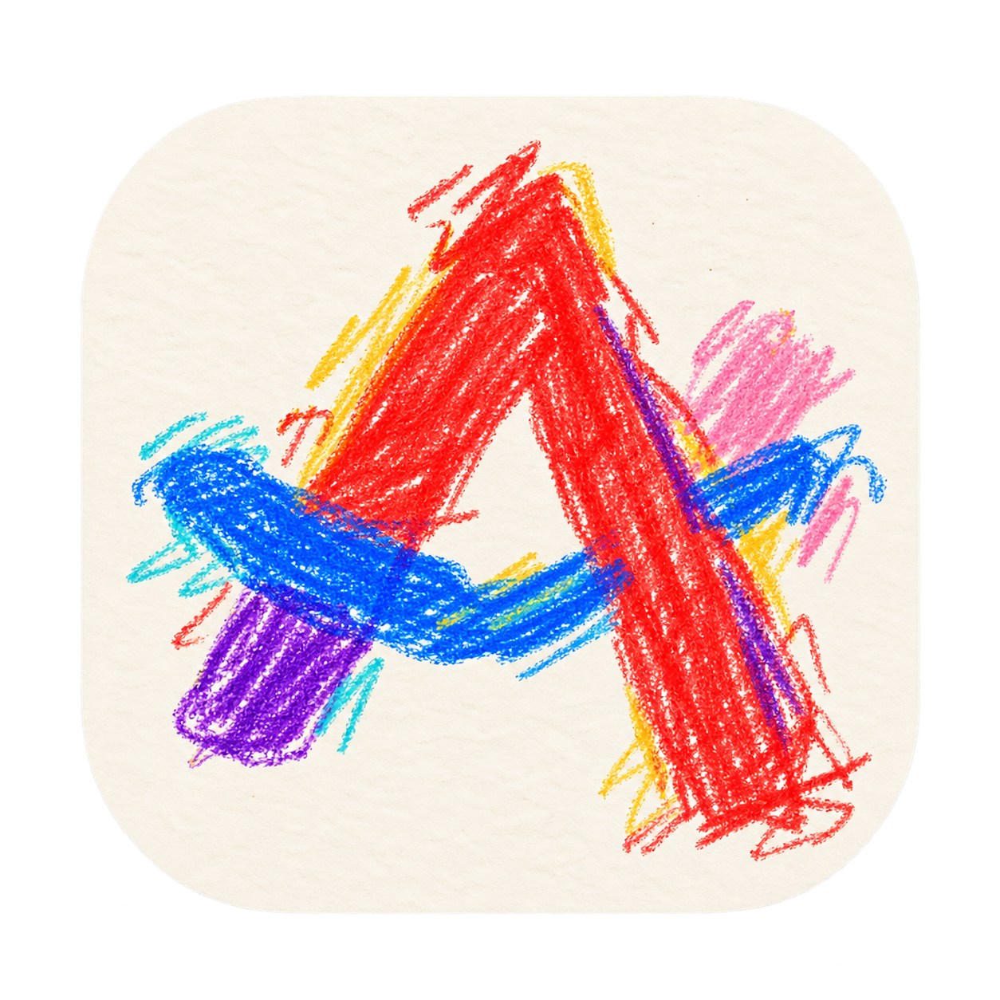

# Ark 0.5.1 prerelease



An open-source macOS browser prototype built with Swift, AppKit, Core Animation, and WebKit. Ark explores a compact sidebar, Spaces, Peek, Split View, and floating video. It is an independent project, not affiliated with Arc, The Browser Company, or Yab, and does not claim feature parity with them.

The original application code is available under the [MIT license](LICENSE). The public source includes no extracted Arc artwork, animation frames, fonts, textures, binaries, or decompiler output. The app icon is a crayon-drawn reinterpretation of Arc’s mark; [branding notes](docs/branding.md) record its source and generation prompt. Sidebar controls use macOS SF Symbols, and the Spaces button uses an original native animation.

[v0.5.1 prerelease](https://github.com/aridutilh/ark/releases/tag/v0.5.1) · [Previous v0.5.0 download](https://github.com/aridutilh/ark/releases/tag/v0.5.0) · [Source repository](https://github.com/aridutilh/ark) · [Feature checklist](FEATURE-INVENTORY.md) · [Validation status](VALIDATION.md)

**Current prerelease: 0.5.1 (build 14).** Sidebar symbols now retain their natural proportions and native SF Symbol tinting instead of being stretched into squares and rasterized before drawing. All seven component and five packaged runtime suites passed, including 63 symbol-rendering checks at 1×/2×. The installed app matched the tested executable and retained all 12 existing tabs. A native check in two main-window Spaces confirmed three round ellipsis dots and readable, correctly proportioned and tinted controls; broader display and animation checks remain open.

**Verified previous release: 0.5.0 (build 13).** That release added page-command confirmations: ⇧⌘C copies the current URL and shows “Page copied”; ⇧⌘R requests a hard refresh and shows “Hard refreshing…”. Both commands follow the key browser window and its active page. All six component and five packaged runtime suites passed. Its installed app matched the tested executable, preserved all 12 existing tabs, and passed a native main-window check of both shortcuts, complete confirmation text and pill dismissal. Multi-surface routing is covered by automated fixtures; broader manual and accessibility coverage remains open. The previous public release is **0.4.0 (build 12)**, which passed its component/runtime suites and received limited user acceptance of PiP corner movement.

## Build and run

Requirements: macOS 14 or later, Xcode Command Line Tools with Swift, and Python 3 for the build helper and local test server.

```sh
bash build.sh
open Ark.app
```

The build targets the current host architecture by default, locally signs `Ark.app`, creates `Ark-macOS.zip`, and runs the model, motion, swipe, tab-search, find, library, and sidebar-symbol rendering suites. `ARK_ARCH` can override the architecture, and `ARK_BUILD_DIR` can override the build directory. The release target is Apple Silicon; Intel compatibility has not been established. The app is a development build, not a notarized distribution.

No package dependencies are fetched by a normal build. A project-local VFS overlay handles a duplicate Swift module map in some Command Line Tools installations without changing the installed toolchain. No Arc installation, reverse-engineering tools, or private research files are needed.

Run the integrated local fixtures after building:

```sh
bash scripts/test-runtime.sh
```

This starts a loopback fixture server and runs the packaged app's WebKit, manual PiP, native interaction, automatic PiP, and feature tests. Tests open native windows. Each run must exit successfully and emit exactly one matching terminal PASS; a subtest PASS or an early zero exit is insufficient. Fixture windows cannot trigger the normal last-window autoquit behavior. **Build 14 passed all seven component and five runtime suites**, including 63 symbol-rendering, 70 positioning, 84 controller interaction, 85 automatic PiP and 137 browsing-feature checks. All 55 source/resource/test/build inputs match the isolated final copy, and the installed app passed strict signature and executable-identity checks. See [VALIDATION.md](VALIDATION.md) for the current run and its limits; these fixtures do not reproduce every device's physical input.

The bundled video is a generated test pattern. To regenerate it, install FFmpeg and run `bash scripts/generate-demo.sh`; FFmpeg is not needed for an ordinary build.

## Implemented browser features

- **Browsing and tabs:** URL entry, DuckDuckGo search, navigation history, reload/stop, zoom, titles, pin/unpin, context menus, and reopen closed tabs.
- **Sidebar and Spaces:** three fixed Spaces, remembered selection, persistent width/visibility, native resize/collapse, and horizontal swiping over the sidebar. The header and bottom controls stay fixed while tab collections follow the gesture.
- **Tab search:** ⌘T opens a palette before creating a tab. Type a URL/search or select an existing tab across Spaces using the arrows and Return. Existing-tab results include Space and URL labels.
- **Peek:** Shift-click a link, or follow a cross-host link from a pinned page, to open a retained overlay. Close it or transfer the same page into a tab, Split View, or Little Ark.
- **Little Ark:** a compact browsing window with address/navigation controls and promotion into the main browser. HTTP(S) URLs delivered by macOS open here. Ark does not automatically make itself the default browser.
- **Split View:** two live pages, draggable divider, per-pane address/navigation controls, focused-pane commands, close-one-pane, and separate-into-tabs. Pair membership is saved.
- **Floating video:** tab/Space departure can move a playing video's existing page into a rounded, borderless panel with native hover controls for play/pause, ±10 seconds, mute/volume, Return to Tab, and resizing. The panel follows the video's aspect ratio. Selecting the source restores it. In the 0.4.0 prerelease, explicit Return also brings Ark forward, restores a minimized source window, dismisses a covering Peek, and focuses the correct Split pane. Hovering and scrolling with two fingers moves the panel. Build 12 directs fast flicks to a corner and attracts slow releases near corners while preserving free placement farther away. Automated checks passed, and one user confirmed the final quick-flick and corner-pull feel on build 12. Build 9 received positive limited feedback on the combined movement/Return/transition check; its assisted Return check alone does not establish cross-app activation. Automatic behavior can be disabled, and manual floating video is available.
- **Page tools:** find in page, full HTTP(S) URL copy, hard refresh, system printing, file-upload selection, and WebKit media permission prompts. Copy and hard refresh show a brief native confirmation pill without taking keyboard focus.
- **Downloads and local Library:** destination selection, progress, cancel, open/reveal, plus a durable visit list and recently closed records. History and recently closed records can be searched and cleared separately. This is not automatic tab archiving.

These are implementation subsets, not a complete browser compatibility claim. See the [working inventory](FEATURE-INVENTORY.md) for explicit acceptance criteria and remaining work.

## Controls

| Action | Control |
|---|---|
| New-tab palette / navigate current page | ⌘T / ⌘L |
| Choose / activate palette result | ↑ / ↓, then Return; Escape cancels |
| Close / reopen tab | ⌘W / ⇧⌘T |
| Peek a link | Shift-click |
| Open link in background / foreground tab | ⌘-click / ⇧⌘-click |
| Open link in Little Ark | ⌥⌘-click |
| Close Peek | Escape, ⌘W, close button or backdrop |
| Promote Peek to tab / Split | ⌘O / ⇧⌘O, or its buttons |
| New Little Ark window | ⌥⌘N while Ark is active |
| Promote / close Little Ark | ⌘O / ⌘W or Escape |
| Split with a new page | ⌥⌘= |
| Close one Split pane | Its × button |
| Separate Split into tabs | View → Separate Split into Tabs |
| Close entire Split group | ⌘W or its sidebar row close button |
| Find / next / previous | ⌘F / ⌘G / ⇧⌘G |
| Copy current URL | ⇧⌘C — “Page copied” |
| Hard refresh | ⇧⌘R — “Hard refreshing…” |
| Print | ⌘P |
| Downloads / history | ⌘J / ⌘Y |
| Recently closed records | History → Recently Closed |
| Toggle / reset sidebar width | ⌘S / ⇧⌘S; double-click its right edge to reset |
| Resize / collapse | Drag the sidebar's right edge |
| Pin / unpin | ⌘D or tab context menu |
| Back / forward / reload or stop | ⌘[ / ⌘] / ⌘R |
| Next / previous tab | Control-Tab / Control-Shift-Tab; sidebar order, not MRU |
| Next / previous Space | Sidebar swipe, or ⌥⌘→ / ⌥⌘← |
| Select Space | ⌥⌘1 / 2 / 3, or bottom buttons |
| Manual floating video | ⌥⌘P or View → Picture in Picture |
| Automatic floating video setting | View → Automatically Show Playing Videos |
| Video demo | View → Open Video Demo |
| Return and select video tab | PiP Return to Tab button, R, or double-click the video background |
| Close floating panel without changing the selected tab | PiP × button or Escape |
| PiP playback / seek / volume / mute | Space / ← or → (10 seconds) / ↑ or ↓ / M; also native overlay controls |
| Move floating video (0.4.0) | Drag its background, or hover and scroll with two fingers; fast flick toward a corner, move slowly for free placement |
| Resize floating video | Drag its bottom-right grip; Tab to the grip and use arrow keys |
| Zoom | ⌘+ / ⌘− / ⌘0 |


Copy and hard refresh target the page in the key browser window: the visible Peek, focused Split pane, Little Ark page, or main tab. They do nothing while an unrelated utility window or the floating-video panel is key. URL copy preserves the current HTTP(S) address, including its query and fragment.

Hard refresh asks WebKit to revalidate the page with its origin, including while a load is in progress. It does not promise an unconditional cache purge and does not clear cookies or other website data. “Hard refreshing…” confirms that a navigation request started, not that loading succeeded. The pill sits near the page's top center, lets clicks pass through, and replaces itself on repeated commands. It holds briefly before fading and respects Reduce Motion.

## Motion and visual design

Sidebar resizing uses a 228-point preferred width, 164–500-point bounds, and an 82-point collapse threshold. Toggle easing lasts 80 ms with cubic control points `(0.25, 0.46, 0.45, 0.94)`. The original analytical spring driver preserves momentum when retargeted; Space paging uses response `0.30` and damping ratio `0.99`. Response describes the spring, not a fixed animation duration. Visible transitions run with the display's refresh cadence. Sidebar pages retain their rows and scroll positions across transitions; a new swipe takes over at the currently displayed offset. A ready single-page snapshot crossfades out over 160 ms after a Space commits. Reduce Motion uses immediate endpoints.

Numeric tuning was informed by local behavioral research. The historical `RecoveredMotion.swift` filename does not imply that its Swift implementation is extracted source. Public code draws its own interface and uses system symbols. The Spaces symbol has its own hover tilt and selection pulse, with no copied geometry or animation keyframes. Reduce Motion applies to sidebar, paging, and symbol animations.

Space swipes tolerate small diagonal or vertical pickup noise before locking direction. Release velocity uses an 80 ms motion window; a tiny final packet does not erase the preceding flick. Established vertical scrolling remains available to the tab list. Automated checks cover these decisions; physical device feel requires a separate check.

Physical testing of v0.3.3 lost the follow-up events for all 12 tiny-start swipes in the captured sample. Version 0.3.4 also handles events in the native tab-list and sidebar receivers, requests horizontal responder forwarding, and processes each event object only once. A new physical sample completed all eight gentle swipes, including their movement, release and Space commit. That sample stayed on the monitored path; receiver-only recovery is covered by automated tests. Native vertical scrolling passed its fixture; broader physical vertical-scroll and device testing remain open.

For an intermittent swipe failure, View → Record Space Swipes (60 Seconds) starts a local diagnostic capture at `~/Library/Caches/Ark/space-swipe-diagnostics.jsonl`. It stops after 60 seconds or 5,000 records and replaces the previous trace only when explicitly started again. Capture is off by default. It records gesture values and routing decisions, excluding URLs, titles, tab identifiers, and page content; no trace is uploaded automatically.

The 0.4.0 media transition keeps the same live web view at its destination size. Static page and video snapshots cover the transfer while WebKit restores layout and completes a bounded rendering wait. Only the inert panel snapshot moves or changes size during Return; the live video viewport is not animated. A timeout cleans up stalled handoffs, and Reduce Motion skips the motion. The controller suppresses its ordinary Space-content crossfade while this handoff is active. One YouTube player rendered correctly in assisted checks on builds 9 and 11; build 11’s native Pause control was also checked. Build 9 received positive feedback on the combined movement, Return and transition check. Build 11’s physical feedback still asked for stronger corner attraction, prompting build 12. These are limited observations, not comprehensive device or player coverage. Build 12’s automated and installation checks passed, and the user accepted its corner movement tuning. That feedback does not verify build 12’s Return transition or cross-app activation. See [validation](VALIDATION.md).

Two-finger panel movement follows physical input and ignores the operating system’s inertial tail. Ark uses its own short velocity estimate. Build 12 directs a fast flick to a corner with deceleration. A wider local attraction zone also pulls slow releases toward nearby corners; positions farther away remain free. Automated checks passed, and one user physically confirmed the final quick-flick and stronger corner-pull feel. Other devices, scrolling preferences and display arrangements remain unverified. Release keeps the panel within visible display bounds. The motion was guided by an Arc reference; the implementation and tuning are Ark’s own. Movement and snapping do not activate Ark; explicit Return does. Placement is not saved across sessions, and edge hiding is not implemented.

## Page ownership and limitations

Floating video uses Ark's own `NSPanel` with reversible HTML5-video isolation in the existing `WKWebView`. It is not AVKit/system Picture in Picture. Detection covers accessible HTML5 video and same-origin frames; protected players and inaccessible cross-origin embeds may not work. Automatic behavior follows tab/Space departures, not macOS app occlusion. Manual PiP from Peek or Little Ark first promotes that page into a main tab.

Peek, Split, and Little Ark promotions transfer the existing view rather than intentionally reload it. A retained Peek lasts only for the current session. Split membership persists; divider position and focused side do not. After quitting, URLs and browser metadata restore, but full back/forward stacks, forms, page memory, and scroll state do not.

The three Spaces share website cookies. Top tiles mirror visible tabs rather than a distinct Favorites collection; closing a pinned row removes it. Local tab search has no network suggestions, history results, or general command execution. Find reports found/no match rather than an exact count and uses one shared query. Downloads are not resumed across app relaunch. The recently closed archive is metadata restoration, not a saved live page.

Important unfinished areas include editable Spaces/profiles, true Favorites and kept-tab semantics, folders/reordering, automatic archive/sleep, production private browsing, extensions, content blocking, password management, sync, Boosts, settings, and an updater. Force Click, Air Traffic Control rules, a system-wide Little Ark hotkey, and four-pane splits are also outside the current subset. WebKit reuse does not supply those browser-host features automatically.

## Local data

For compatibility with development sessions, the app still stores metadata under `~/Library/Application Support/OrbitPrototype/` and retains its original bundle identifier. The test server variable is likewise still named `ORBIT_TEST_URL`; `scripts/test-runtime.sh` sets it automatically. These legacy names do not require a separate Orbit installation.

WebKit owns website data. Clearing Ark's visit list or recently closed records does not clear cookies or delete downloaded files. `--fresh-preview` uses ephemeral browsing/session state for development; it is not a complete user-facing private-window feature. Normal certificate verification remains enabled, and ordinary HTTP pages are allowed. Runtime operation does not read or modify Arc's installation or profiles.
