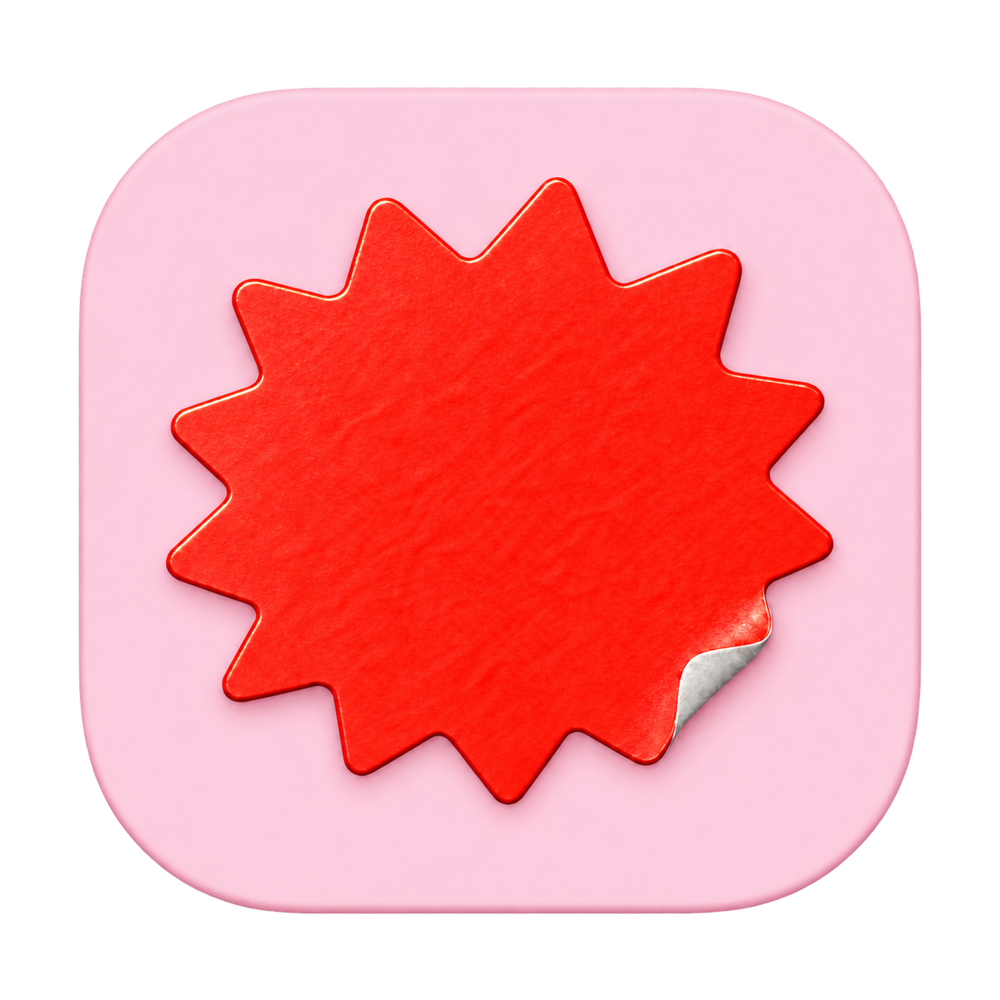

# Bam 💥



A small, fast, slightly obsessive macOS browser prototype. Native Swift + AppKit + WebKit, hand-tuned springs, zero Electron.

Bam explores the things that make sidebar browsers feel good: a compact sidebar with **Spaces**, a **Peek** overlay for glancing at links, **Split View**, a pocket-sized **Little Bam** window, and a **floating video panel** you can flick into a corner. It's an independent open-source experiment — not affiliated with Arc, The Browser Company, or Yab, and not claiming feature parity with any of them. Think of it as a love letter written in its own handwriting.

**Latest download:** [v0.21.2 prerelease](https://github.com/aridutilh/bam/releases/tag/v0.21.2) · [all releases](https://github.com/aridutilh/bam/releases) · [changelog](CHANGELOG.md)

**Bam 0.22.1 (build 46, local draft)** refines the sidebar after a real Arc import: balanced Favorites with crisp 16-point icons, hover state that follows the pointer across Space changes, distinct pointer/keyboard folder focus, original open/closed folder glyphs, and a simpler Downloads/Spaces/New Tab footer. Inactive unsaved blank-tab rows are hidden without removing their session data. Imported folders disclose that they contain saved links and do not refresh automatically. Build and native acceptance are tracked in [validation](VALIDATION.md); no release or production installation is implied.

**Bam 0.22.0 (build 45, local draft)** adds nested folders and Arc sidebar import with a preview, repeat-import deduplication, profile-scoped Favorites, saved Splits, cached per-tab icons and Space theme colors/gradients. Easels retain their names and sidebar positions as native references; their canvases stay in Arc. Sidebar drag/drop, keyboard focus and light/dark appearance are included. The component build and all eleven native suites passed at the recorded checkpoints in canonical Bam Preview; later targeted runs and remaining limits are recorded in validation. Manual checks cover themed light/dark appearance, rename, recolor, Space switching, recessed Favorites, monograms and narrow title fades. Extension gains include actual loopback filtering by uBlock Origin Lite after its initialization delay, Dark Reader styling, and corrected Bitwarden/Proton startup paths; account and vault workflows are not certified. See [validation](VALIDATION.md) for exact scope and limitations. Nothing from this draft has been released.

**Bam 0.21.3 (build 44, unreleased draft)** restores the construction icon for fresh and persistent development previews and guards each persistent profile with an exclusive process lock. A second launch focuses the owner and exits before opening shared WebKit stores. Fresh previews and runtime fixtures remain disposable and unlocked. Normal builds keep the regular icon, bundle ID and `OrbitPrototype` profile. Older versions do not participate in the lock: quit them before opening this draft against the same persistent profile. This draft awaits review and merge before installation; no release is being published.

**Bam 0.21.2 (build 43)** ships the unified extension library, Chrome worker compatibility, Safari import/refresh controls, SVG favicons and the fixes developed in the drafts below. It also fixes Chrome-style detached `setIcon` calls in native extension documents, allowing vendor-supplied toolbar status colors to update. Real Dashlane checks show orange while signed out and teal while authenticated; the updated preview also fills the saved dummy login exactly. Native checks cover the same sidebar button changing its global/tab icon, title and badge. Bam does not infer vault state.

**Bam 0.21.1 (build 42, local draft)** addresses Dashlane’s inline panel disappearing on pages with a closed dropdown. A narrow content-script adapter uses WebKit’s native picker state when its overlay style is unavailable; the signed-in panel now stays open. Recreated standard and dynamic forms filled both dummy values correctly, and a full-page vault copy/paste check passed. Fresh-load form classification and iframe injection still need work. See [validation](VALIDATION.md) for the tested scope.

**Bam 0.21.0 (build 41, local draft)** adds a separately reviewed desktop-message bridge for the verified Chrome build of 1Password, Safari refresh/recovery controls, and bounded extension lifecycle checks. Real 1Password desktop pairing still requires an Apple-signed Bam build, the official desktop app and vendor trust approval; it has not been demonstrated in this draft. **Bam 0.20.1 (build 40, local draft)** fixes SVG favicons, including the inline disco-ball emoji on aridutilh.com, with isolated rendering and cached PNGs. **Bam 0.20.0 (build 39, local draft)** adds a limited compatibility layer for Chrome-style service workers, packaged WebAssembly support, and reviewed import of Safari WebExtensions from installed signed Mac App Store apps. Chrome, Firefox and Safari remain searchable in one themed library, with visible extension icons and real popups. Initial Safari app acquisition still opens the App Store; Safari companion handlers, other external native hosts and universal extension compatibility remain unsupported. The isolated development preview retains its own installs and sign-ins. See [extension notes](docs/extensions.md) for exact observations and limits. **Bam 0.17.0 (build 35)** dresses the first-run welcome in the bambrowser.com look, lets you remap the main shortcuts from Settings ▸ General (click a keycap, press a chord; collisions are refused), and rebuilds Settings ▸ Spaces as a list with one editor and a Switch-to pill. **Bam 0.16.0 (build 34)** dresses Settings, Manage Spaces, Extensions, Downloads and History in the bambrowser.com look, bundles the site’s typefaces, and gives Little Bam a translucent bar with extensions, Copy Link and an Open-in-Space picker. A collapsed sidebar now hands the page the whole window, and a first launch opens bambrowser.com.
**Bam 0.15.2 (build 33)** sent Safari's user-agent suffix from tabs, Peek and Little Bam so streaming sites negotiate FairPlay playback as they do in Safari. **Bam 0.15.1 (build 32)** retains the 0.15.0 Settings and palette commands and improves tab search, history saving and extension queries. [Performance round 2](docs/performance-round2.md) records the measured gains and the remaining memory and cross-browser questions.

**Bam 0.14.0 (build 30)** adds full-color website favicons to sidebar rows, Favorites and command-palette results. Icons load asynchronously, stay cached per login profile, and preserve your custom saved icons. This version also includes the Default-profile startup correction for 0.13.1. See [CHANGELOG.md](CHANGELOG.md) and [VALIDATION.md](VALIDATION.md).

## Try it

You'll need macOS 14+, the Xcode Command Line Tools (with Swift), and Python 3.

```sh
bash build.sh
bash scripts/preview-draft.sh
```

That builds for your machine, locally signs the app, and runs the component test suites. Every interactive test build then replaces the single **/Applications/Bam Preview.app**, with construction artwork and a stable `com.ari.bam.preview` identity. All worktrees share its `BamPreview` profile, preferences and WebKit namespace. Quit Bam Preview before replacing it; a running preview is never stopped automatically. Use `bash scripts/preview-draft.sh --fresh` for a disposable session or `bash scripts/preview-onboarding.sh` for the disposable welcome. `--prepare-only` installs without launching; `bash scripts/test-runtime.sh` tests that canonical preview by default.

Bam has exactly two app names: **Bam Preview** for unmerged work and **Bam** for merged main. Do not create feature-specific copies or launch the branch's generated `Bam.app` outside explicit fixture modes. `/Applications/Bam.app` is never changed by the preview scripts. The older preview bundle may be replaced only if its identifier belongs to `com.ari.bam.*preview`; its old profile, preferences, cookies and vault state are preserved in place, without import into the new namespace. This development build is ad-hoc signed, not notarized.

## What's in the box

- **Spaces** — up to 32 of them, each with a name, an icon, and a color. Create, reorder, recolor, and delete them in Manage Spaces; changes stage until you hit Save, and deleting a Space asks where its tabs should live next. Swipe the sidebar to glide between them.
- **Favorites and kept tabs** — up to twelve Favorite tiles per profile, shared across its Spaces, plus kept rows within each Space. Closing a saved page unloads it; selecting it wakes it. Names, icons, and original addresses stay saved, with edit, reset, and ordering controls in the context menu.
- **Light or dark** — View ▸ Appearance (or Settings ▸ General) picks System, Light or Dark for the whole browser, Little Bam and Settings included. Light mode wears pale washes of each Space's color with dark text and a white selected tab; Picture in Picture stays dark.
- **Folders** — group kept tabs into named folders inside a Space, nest them, collapse them, rename, reorder, move them to another Space or ungroup them, all from the context menu (Tabs ▸ New Folder… too). A collapsed folder still shows the tab you're on. Folders hold kept tabs only; a Split moves as one row. Drag rows to reorder them, drop one on a folder to file it, drag into Today to unkeep it, or drop it on a Space icon in the footer to move it there.
- **Import from Arc** — File ▸ Import from Arc… (or Settings ▸ General) reads Arc's sidebar layout file, `StorableSidebar.json`, without changing it. You get a preview first: Spaces with their emoji, nested folders, kept tabs, Today tabs, Favorites per login profile and Splits, plus a plain list of what can't come over exactly (Easel canvases — each Easel is kept as a named reference row in its place — live-folder updates, Arc's grain and vibrancy, Favorites from Arc profiles no Space uses). A themed Arc Space keeps its own colors and two-color gradient in light and dark; Bam eases the gradient where needed so text stays readable, and choosing another Space color replaces it. Choose the Spaces to import, whether to include Today and Favorites, and whether to recover Favorites from other Arc profiles. Imported pages stay asleep until you open one, and importing again adds only what's new. A custom Arc profile becomes a separate Bam login profile, initially signed out. There is no one-step undo after a successful import. It's a layout import: sign-ins, passwords, history and extensions stay in Arc.
- **Login profiles** — assign the same profile to Spaces that should share logins, or separate profiles to keep website data, Favorites, history, and extensions apart. Existing Spaces keep the Default profile. Moving loaded pages between profiles asks before reloading them.
- **Extensions** — the puzzle icon at the end of the address field opens the unified library while no extensions are installed; afterwards their icons sit in a row under it. Search names across Chrome, Firefox and Safari sources or paste a store/package link; review permissions once before enabling. Click an installed extension’s icon to open its popup; the puzzle menu includes overflow and management. Store builds retain publisher verification and manual updates; Safari results import a WebExtension from the installed signed containing app; if needed, first get that app from the App Store. Runtime support needs macOS 15.4+. [Extension notes](docs/extensions.md) record exact compatibility observations.
- **A lighter browser** — sidebar rows are reused and chrome updates are coalesced; session files save on a background writer. Under critical memory pressure, ordinary static pages idle for ten minutes can sleep while the three most recently used loaded pages stay warm. Saved tabs, Splits, video, forms, scripts, and uncertain activity stay protected. See the [tab performance notes](docs/tab-performance.md) for the policy and its limits.
- **Website icons** — full-color favicons in the sidebar, Favorites and tab search, plus site-search results. Public raster and SVG icon declarations (including embedded emoji) and `/favicon.ico` load directly with a bounded, profile-scoped cache; no third-party favicon service. Custom saved icons take priority, and missing icons retain native symbols.
- **Tab search** — ⌘T opens a palette *before* making a tab. Type a URL or search, jump to a tab you already have open in any Space, or type a command — “settings”, “history”, “downloads” — and press Return. Fewer duplicate tabs, more smugness.
- **Settings, Bam-style** — ⌘, opens a settings window that looks like bambrowser.com: pink paper (plum in dark mode), white cards, sticker-red toggles. Default search engine, playback and memory toggles, per-Space names, colors and icons, extensions and About. No Aqua in sight.
- **Peek** 👀 — shift-click a link to open it in an overlay without leaving your page. Like it? Promote it to a tab, a Split pane, or Little Bam. Done? Escape and it's gone.
- **Split View** — two live pages side by side with a draggable divider and per-pane controls. The pair sticks together in the sidebar and survives restarts.
- **Little Bam** — a compact companion window with a translucent bar: profile chip, site name (click to edit), extensions, Copy Link and *Open in Space* with a picker for any other Space. When macOS hands Bam a link to open, it lands here instead of blowing up your main window; promote one with ⌘O when it earns the big screen. (Bam never makes itself your default browser behind your back.)
- **Floating video** — leave a tab while a video is playing and the video keeps playing in a rounded floating panel with hover controls. Flick it hard and it glides to a corner; drag it gently and it stays where you put it. Hit Return-to-Tab and Bam takes you back to the source. (This is Bam's own panel doing reversible HTML5-video tricks, not system Picture-in-Picture — protected players may refuse to come along.)
- **The usual suspects** — find in page, reopen closed tab, downloads, searchable history, hard refresh, printing, zoom, a little confirmation pill that tells you your ⇧⌘C actually copied the URL, and a confirmation before quitting.

Every one of those is a working subset, not a finished browser feature — the [feature inventory](FEATURE-INVENTORY.md) tracks exact acceptance criteria and what's left.

## Shortcuts you'll actually use

| | |
|---|---|
| ⌘T / ⌘L | Tab palette / edit current URL |
| Shift-click | Peek a link |
| ⌘O | Promote Peek or Little Bam to a tab |
| ⌥⌘= | Split with a new page |
| ⌥⌘N | New Little Bam window |
| ⌥⌘→ / ⌥⌘← | Next / previous Space (or swipe the sidebar) |
| ⌥⌘1…9 | Jump to a Space |
| ⌘S | Toggle the sidebar (collapsed, the page fills the window) |
| ⌥⌘P | Float the current video |
| ⇧⌘C / ⇧⌘R | Copy URL / hard refresh |

<details>
<summary>The full list, for completionists</summary>

| Action | Control |
|---|---|
| Choose / activate palette result | ↑ / ↓, then Return; Escape cancels |
| Move around the sidebar from the keyboard | ⌃⌘S to focus it, ↑ / ↓ to move (nothing opens), Return to open, → / ← to open or close a folder (← also jumps to the folder you're in), Escape back to the page |
| Close / reopen tab | ⌘W / ⇧⌘T |
| Open link in background / foreground tab | ⌘-click / ⇧⌘-click |
| Open link in Little Bam | ⌥⌘-click |
| Close Peek | Escape, ⌘W, close button, or backdrop |
| Promote Peek to tab / Split | ⌘O / ⇧⌘O, or its buttons |
| Promote / close Little Bam | ⌘O / ⌘W or Escape |
| Copy Little Bam’s link | ⇧⌘C |
| Close one Split pane | Its × button |
| Separate Split into tabs | View → Separate Split into Tabs |
| Close entire Split group | ⌘W or its sidebar row close button |
| Find / next / previous | ⌘F / ⌘G / ⇧⌘G |
| Print | ⌘P |
| Downloads / history | ⌘J / ⌘Y |
| Recently closed | History → Recently Closed |
| Reset sidebar width | ⇧⌘S, or double-click its right edge |
| Resize / collapse sidebar | Drag its right edge |
| Keep / stop keeping a tab | ⌘D or tab context menu |
| Favorite / remove Favorite | ⇧⌘D or tab context menu |
| Sleep idle pages / keep this site awake | View menu |
| Back / forward / reload or stop | ⌘[ / ⌘] / ⌘R |
| Next / previous tab | Control-Tab / Control-Shift-Tab (sidebar order) |
| Settings | ⌘, or type “settings” into the palette |
| Edit Spaces | Tabs → Manage Spaces, the sidebar Space heading, or Settings → Spaces |
| Move tab or Split pair to a Space | Tab-row context menu → Move to Space |
| Automatic floating video on/off | View → Automatically Show Playing Videos |
| Return to the video's tab | PiP Return button, R, or double-click the panel |
| Close the panel, keep your tab | PiP × button or Escape |
| PiP playback / seek / volume / mute | Space / ← → (10s) / ↑ ↓ / M, plus hover controls |
| Move the panel | Drag it, or hover and two-finger scroll; fast flicks seek corners |
| Resize the panel | Drag its bottom-right grip (Tab + arrows works too) |
| Zoom | ⌘+ / ⌘− / ⌘0 |

</details>

## Honesty corner 🪞

Bam is a prototype, and it says so with its chest:

- **Profiles share deliberately.** Spaces assigned to the same profile share website data; use separate profiles for separate sign-ins.
- **Extension compatibility is limited.** Signed-in Dashlane Firefox 6.2643.0 has demonstrated popup search, manual saving of an invented login and inline filling on a simple loopback form. The dropdown panel now stays visible, recreated standard/dynamic forms and full-page copy/paste pass exact dummy checks, and restart/unlock preserves the test item. Fresh-load classification, iframe injection, broader update and passkey workflows remain incomplete. Chrome workers receive a limited compatibility layer. Safari imports preserve the signed bundle and require reviewed refresh after containing-app updates. A separately reviewed native-message transport exists only for verified Chrome 1Password; real desktop pairing/Touch ID remain unverified and are refused by the ad-hoc preview. Safari companion handlers and other native hosts remain unsupported. There is no universal extension compatibility.
- **No** built-in content blocking, password manager, sync, user-facing private-browsing mode, or auto-updater. Browser import covers Chrome's bookmark bar (onboarding) and Arc's sidebar layout only — no passwords, cookies, history or extensions, and Arc's Split encoding is tested only against synthetic data. Settings cover search, playback, memory, Spaces and extensions — not site permissions.
- Relaunching restores your tabs and layout, but not scroll positions, form contents, or back/forward stacks. Sleeping a page during a session retains its URL and scroll position; waking reloads the page.
- Session migration is forward-only; older builds do not understand all of the saved-tab and profile metadata.
- Downloads don't resume after relaunch, and "recently closed" restores metadata, not a frozen live page.
- Intel Macs are unverified territory; the release target is Apple Silicon.

The [feature inventory](FEATURE-INVENTORY.md) has the full to-do list, and [VALIDATION.md](VALIDATION.md) records exactly what's been tested, how, and what hasn't.

## Nerd notes 🔬

- **Testing:** `bash scripts/test-runtime.sh` spins up a local fixture server and runs the packaged app through WebKit, PiP, native-interaction, and feature suites — hundreds of checks, real windows opening on your screen. Don't panic; that's the test.
- **Motion:** the sidebar and Space paging run on an analytical spring driver that preserves momentum when retargeted, and everything respects Reduce Motion. If a swipe ever misbehaves, View → Record Space Swipes captures a 60-second local-only diagnostic trace (gesture data only — no URLs, titles, or page content, and nothing uploaded).
- **Legacy paths, on purpose:** the bundle identifier is still `com.ari.orbitprototype`, app data lives in `~/Library/Application Support/OrbitPrototype/`, and the diagnostic cache in `~/Library/Caches/Ark/`. Bam grew out of earlier prototypes named Orbit and Ark, and keeping the old names means your tabs survive every rename. One day there'll be a tested migration; until then, the fossils stay.
- **Build knobs:** `BAM_ARCH` overrides the target architecture and `BAM_BUILD_DIR` the build directory. No package dependencies are fetched by a normal build.

## License & provenance

The original application code is [MIT licensed](LICENSE). The public source contains no extracted Arc artwork, animation frames, fonts, textures, binaries, or decompiler output — the interface is drawn from scratch with macOS SF Symbols, the motion tuning is Bam's own, and the burst-sticker icon is original (see the [branding notes](docs/branding.md) for its story).

Built with care, springs, and an unreasonable number of runtime checks. 💥
